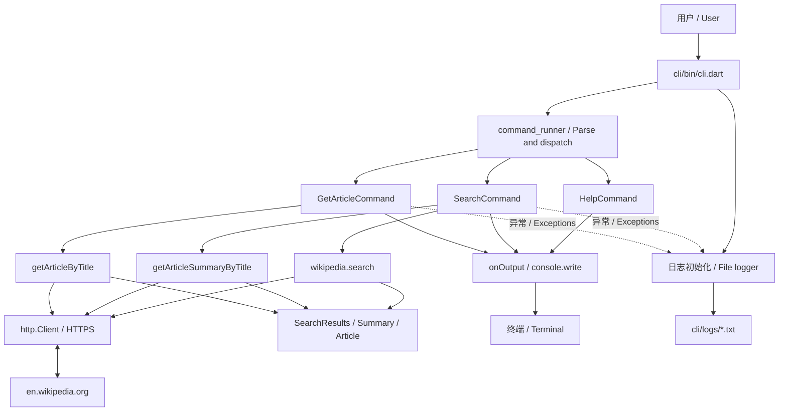

# Dartpedia

[中文](README.md) · [Architecture and flows](docs/ARCHITECTURE.md) · [Project analysis](docs/PROJECT_ANALYSIS.md)

Dartpedia is a Dart command-line project for searching English Wikipedia, reading article extracts, and retrieving summaries. Three packages share a Dart Pub Workspace. This is a pure Dart application.

## Core feature index

| Feature | Description | Source |
| --- | --- | --- |
| Article search | `search`: return matching titles and URLs | [SearchCommand](cli/lib/src/commands/search.dart) |
| First-result summary | `search --im-feeling-lucky`: show the first summary and all results | [SearchCommand](cli/lib/src/commands/search.dart) |
| Article reading | `article`: retrieve an extract by title; defaults to `cat` | [GetArticleCommand](cli/lib/src/commands/get_article.dart) |
| Command help | `help`: list commands and describe options | [HelpCommand](command_runner/lib/src/help_command.dart) |
| Random summary API | Library function `getRandomSummary()` | [Summary API](wikipedia/lib/src/api/summary.dart) |
| Error logging | Record runtime exceptions to local log files | [Logger](cli/lib/src/logger.dart) |

## Getting started

Install a Dart SDK satisfying `^3.13.5`. Network access to `en.wikipedia.org` is required for API commands. No API key or Flutter installation is required. Run from the repository root:

```sh
dart pub get
dart run cli/bin/cli.dart help
dart run cli/bin/cli.dart help --verbose
dart run cli/bin/cli.dart help --command search
dart run cli/bin/cli.dart search "Dart programming language"
dart run cli/bin/cli.dart search "Dart programming language" --im-feeling-lucky
dart run cli/bin/cli.dart article "Dart (programming language)"
dart run cli/bin/cli.dart article
```

Quote multiword arguments. Running without arguments returns silently. API calls are hardcoded to English Wikipedia.

## Layout and design

| Path | Responsibility |
| --- | --- |
| `cli/` | Entrypoint, application commands, logging |
| `command_runner/` | Command registration, parsing, help, terminal utilities |
| `wikipedia/` | HTTP calls, JSON models, fixtures |
| `docs/` | Bilingual architecture, flows, and analysis |
| `docs/diagrams/` | Editable Mermaid sources |
| `scripts/` | Release packaging |
| `pubspec.yaml`, `pubspec.lock` | Workspace configuration and locked dependencies |



## Validation and limitations

```sh
dart analyze
(cd wikipedia && dart test)
(cd command_runner && dart test)
```

Verified on 2026-10-11: three model tests and one placeholder command-runner test passed; the help command ran successfully. Analysis reported three warnings and seven informational issues, exiting with code 2. The CLI test file is empty. Live API requests were not verified. See [analysis](docs/PROJECT_ANALYSIS.md) for dependency, argument metadata, empty-result, and exit-status limitations. Existing tests do not establish end-to-end correctness.
