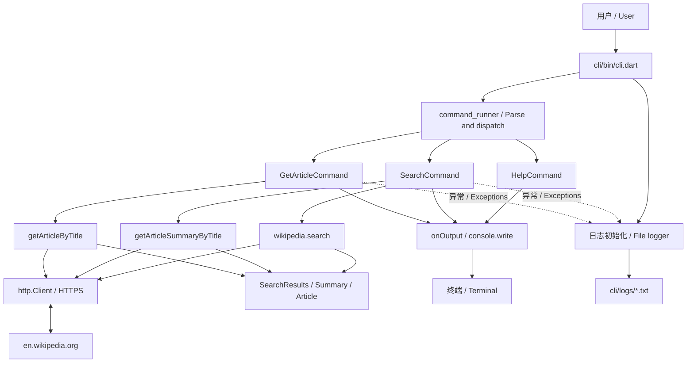

# Dartpedia

[English](README.en.md) · [架构与流程 / Architecture & flows](docs/ARCHITECTURE.md) · [项目分析 / Analysis](docs/PROJECT_ANALYSIS.md)

Dartpedia 是一个使用 Dart 构建的 Wikipedia 命令行项目，通过英文 Wikipedia 搜索文章、读取正文和获取摘要。项目使用 Dart Pub Workspace 管理三个包；它不是 Flutter 应用。

## 核心功能索引

| 功能 | 说明 | 代码入口 |
| --- | --- | --- |
| 文章搜索 | `search`：按关键词返回标题和链接 | [SearchCommand](cli/lib/src/commands/search.dart) |
| 首条结果摘要 | `search --im-feeling-lucky`：显示首条摘要和全部结果 | [SearchCommand](cli/lib/src/commands/search.dart) |
| 文章阅读 | `article`：按标题读取正文，默认 `cat` | [GetArticleCommand](cli/lib/src/commands/get_article.dart) |
| 命令帮助 | `help`：查看命令及选项说明 | [HelpCommand](command_runner/lib/src/help_command.dart) |
| 随机摘要 API | 库函数 `getRandomSummary()` | [Summary API](wikipedia/lib/src/api/summary.dart) |
| 错误日志 | 记录运行异常到本地日志文件 | [Logger](cli/lib/src/logger.dart) |

## 环境与启动

需要满足 `sdk: ^3.13.5` 的 Dart SDK，以及访问 `en.wikipedia.org` 的网络。无需 API Key，无需 Flutter。以下命令均在仓库根目录执行：

```sh
dart pub get
dart run cli/bin/cli.dart help
dart run cli/bin/cli.dart help --verbose
dart run cli/bin/cli.dart help --command search
dart run cli/bin/cli.dart search "Dart programming language"
dart run cli/bin/cli.dart search "Dart programming language" --im-feeling-lucky
dart run cli/bin/cli.dart article "Dart (programming language)"
dart run cli/bin/cli.dart article
```

多词参数需要引号。直接运行不带参数的 CLI 会静默返回。API 固定使用英文站点；中文文档不代表支持中文 Wikipedia 数据源。

## 项目结构

```text
cli/                 应用入口、搜索/文章命令、文件日志
command_runner/      命令注册、参数解析、帮助、终端工具
wikipedia/           HTTP API、数据模型、JSON 测试样本
docs/                中英文架构、流程与项目分析
docs/diagrams/       可编辑 Mermaid 图源
scripts/             交付文件打包工具
pubspec.yaml         Workspace 与 SDK 约束
pubspec.lock         依赖锁定
```

## 架构



更多流程图见 [架构文档](docs/ARCHITECTURE.md)。

## 验证与当前限制

```sh
dart analyze
(cd wikipedia && dart test)
(cd command_runner && dart test)
```

2026-10-11 验证：模型测试 3 项通过，命令包占位测试 1 项通过，`help` 可运行。静态分析发现 3 个 warning、7 个 info，退出码 2；CLI 测试文件为空。未验证实时 API 请求。依赖声明、参数必填标记、空搜索结果和错误退出码等问题详见 [项目分析](docs/PROJECT_ANALYSIS.md)。这些测试不等同于功能端到端验证。
