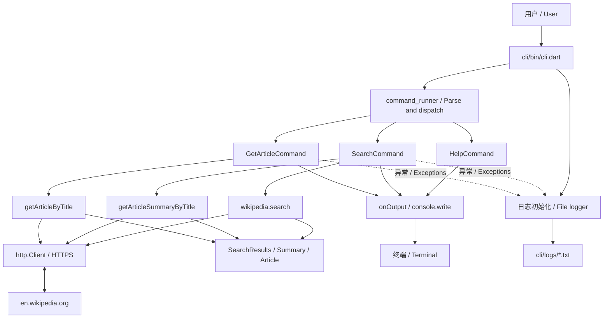
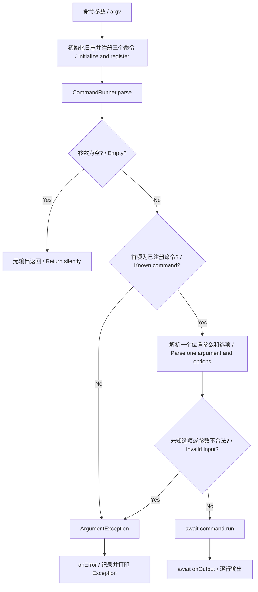
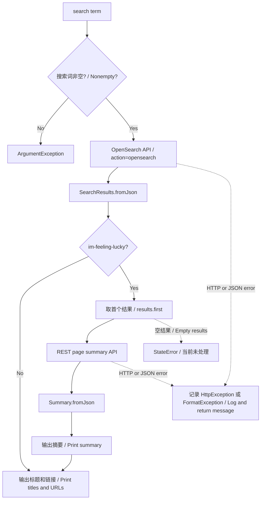
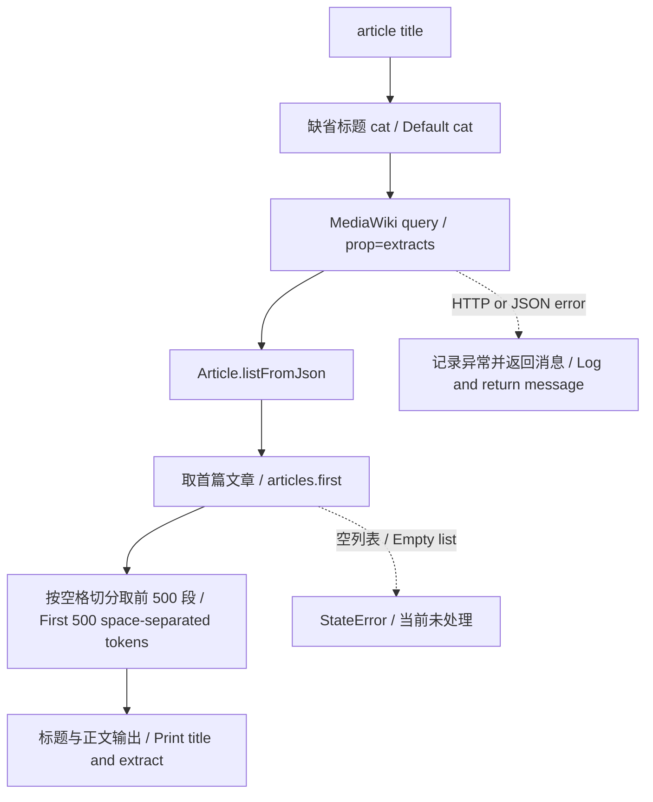

# 架构与功能流程 / Architecture and functional flows

图按当前源码绘制，包含已知失败路径。GitHub 可直接渲染 Mermaid。
Diagrams reflect current source behavior, including known failure paths. GitHub renders Mermaid directly.

## 整体架构 / Overall architecture

## 命令分发 / Command dispatch

## 搜索与幸运摘要 / Search and lucky summary

## 文章读取 / Article retrieval

## 边界 / Boundaries

- CLI 组织用户操作，命令包不直接访问 Wikipedia；API 包不依赖 CLI。CLI coordinates user actions; the runner does not call Wikipedia, and the API package does not depend on CLI.
- 图表示源码调用关系，实际依赖声明存在遗漏。Diagrams show source-level calls; package dependency declarations have omissions.
- 每个 API 函数创建独立 http.Client，并在 finally 中关闭。Each API function creates its own HTTP client and closes it in finally.
- 无数据库、缓存、Web 服务或 UI；数据来自远端，日志存于本地。There is no database, cache, web server, or graphical UI; data is remote and logs are local.
- 随机摘要示例位于 wikipedia/bin/wikipedia.dart，调用 getRandomSummary，与主 CLI 入口独立。The random-summary example is a separate entrypoint in wikipedia/bin/wikipedia.dart.
